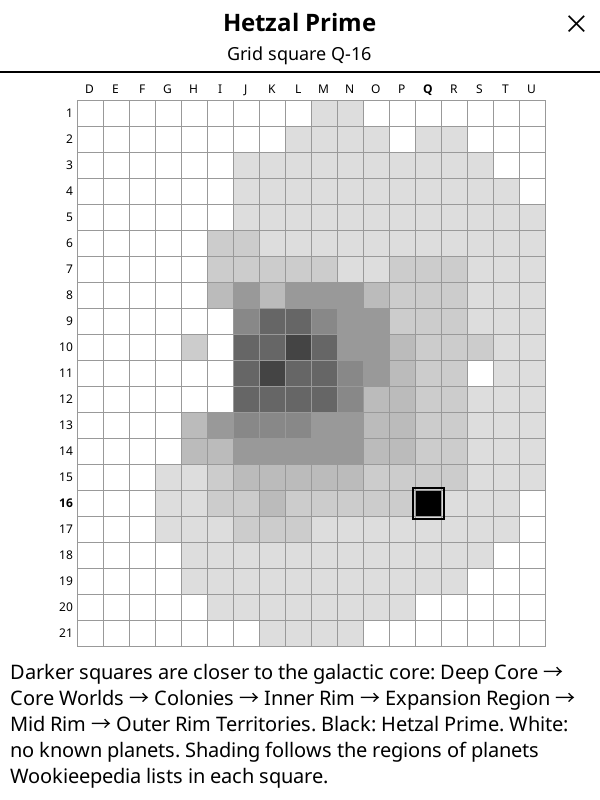
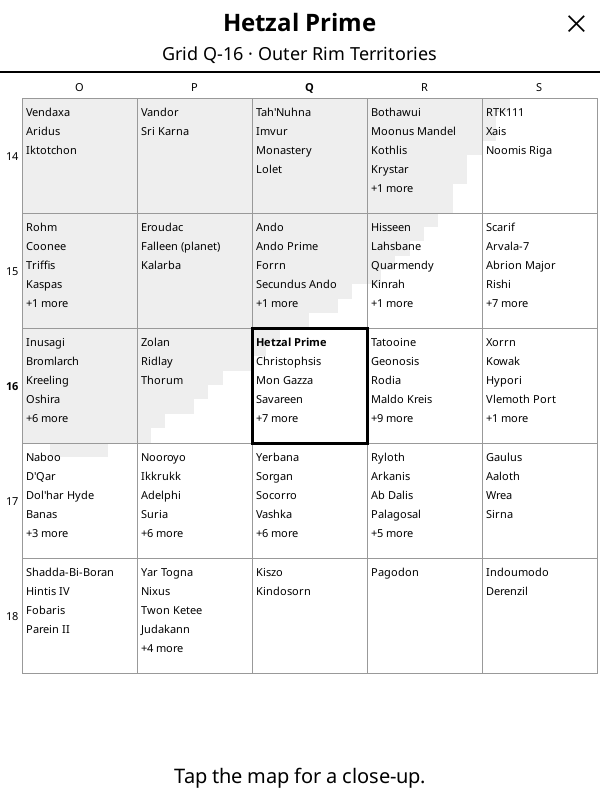

# Wookieepedia for KOReader

A [KOReader](https://github.com/koreader/koreader) plugin that looks up Star Wars characters, species, planets and terms on [Wookieepedia](https://starwars.fandom.com) while you read. It works like KOReader's built-in Wikipedia lookup, but it is made for e-ink and for spoiler-sensitive readers. It started with *The High Republic*, which drops a lot of new names on you.

 

## Features

**Look things up**
- **Wookieepedia** button in the text-selection popup: select a name such as "Avar Kriss" and tap it.
- **Wookieepedia** button in the dictionary popup: long-press a single word.
- **Search (🔍) → Wookieepedia** menu: search by typing, open the galaxy map, toggle the spoiler shield and manage saved articles.
- Follows redirects (*Rey* → *Rey Skywalker*). Offers a pick list for disambiguation pages (*Mace*) and for selections that don't match a title exactly (*avar kriss*).
- Shows plain text made for e-ink, without infobox tables, citation marks, notice boxes or the *Behind the scenes*, *Appearances* and *Sources* sections.
- Shows the **intro only** by default, which is quick and keeps spoilers down. **Full article** is one tap away.

**See what they look like**
- **Portrait:** characters, species, creatures, ships and most other articles have a **Portrait** button that shows the article's main picture full screen.
- **Species button:** a character's article has a button named after their species (*Lourna Dee* → **Twi'lek**) that shows the species' picture right away. Hybrids get a **Species** button with a choice; humans get no button.

**Find planets**
- Planet articles show a **location line** (region, sector, system, grid square) and a **Map** button. Tap the map to switch views:
  - **Galaxy:** the whole grid with region names, landmark planets and the planet ringed.
  - **Close-up:** the 5×5 squares around the planet, with the best-known planets in each.
  - **Atlas** (optional): a galaxy map image of your own with the square marked (see [DEV.md](DEV.md#optional-atlas-image)).

**Avoid spoilers**: the spoiler shield is on by default and has two layers:
- **Intros** show only their first paragraph, which usually says who or what it is. Wookieepedia intros often summarize a character's whole story, so the rest stays behind **Show more**.
- **Full articles** hide every paragraph sourced from a book, comic or audio drama that comes later in your reading order. Wookieepedia cites the source of nearly every paragraph. Films and TV are always shown; reference works (Databank, encyclopedias, magazines) don't count either way. Hidden parts appear as "[3 paragraphs hidden…]", and **Show hidden** reveals them after you confirm.
- Your position in the reading order follows the book you open and is remembered, or you can set it in the menu. Today the plugin knows the **High Republic** main-story order (from the r/Highrepublic wiki). Until a position is known, every book-sourced paragraph counts as unread and stays hidden; set a position or turn the shield off in the menu.

**Works offline**
- Every article and picture you open is saved on the device. Looking it up again needs no Wi-Fi. **Refresh** updates an article, and the menu clears everything.
- Downloads can be cancelled with a tap. If Wi-Fi is off, KOReader offers to turn it on.

## Install

1. Download `wookieepedia.koplugin-<version>.zip` from the [latest release](../../releases/latest) and unzip it. You get a folder named `wookieepedia.koplugin`.
2. Copy that folder into KOReader's `plugins/` directory:
   - Kindle: `koreader/plugins/`
   - Kobo: `.adds/koreader/plugins/`
   - PocketBook: `applications/koreader/plugins/`
   - Android: `koreader/plugins/` on the internal storage
   - macOS desktop: `~/Library/Application Support/koreader/plugins/`
3. Restart KOReader.

The folder name must stay `wookieepedia.koplugin`. To update, replace the folder; your saved articles live elsewhere and are kept.

Requires a recent KOReader (developed against v2026.07). It has been tested on a Kindle and on the macOS desktop build. Reports from other devices are welcome.

## Where data goes

- **Network:** the plugin talks only to Wookieepedia's MediaWiki API (`starwars.fandom.com`) and its image server (`static.wikia.nocookie.net`), and only when you look something up or tap **Portrait**. It sends no analytics. Requests identify themselves as `wookieepedia.koplugin/<version>`.
- **On the device:** saved articles and pictures are in `<koreader data>/wookieepedia/`, settings in `settings/wookieepedia.lua`.

## Development

See [DEV.md](DEV.md) for the emulator setup, the edit/restart loop, logs, tests, deploying to a device and making a release.

```sh
tools/run.sh       # launch the KOReader emulator with the test book
spec/run.sh        # run the unit tests
luacheck .         # lint
tools/package.sh   # build the release zip
```

| File | Purpose |
|---|---|
| `_meta.lua` | Plugin name and description shown in KOReader |
| `main.lua` | UI: popup buttons, menu entry, article viewer, portraits, error messages |
| `wookapi.lua` | Requests to the Wookieepedia MediaWiki API and interpretation of responses |
| `wookhtml.lua` | Fast HTML → plain-text conversion for article content |
| `wookcache.lua` | Saved articles and pictures for offline lookups |
| `wookmap.lua` | Galaxy map screen |
| `wookspoiler.lua` | Spoiler filter: reading position, source classification, paragraph hiding |
| `data/reading_order.lua` | Generated High Republic reading order with Wookieepedia titles |
| `data/galaxy_grid.lua` | Generated region shading per grid square |

The galaxy and close-up views are generated entirely from data: the grid squares and regions Wookieepedia lists for about 1,400 canon planets. Region shapes are smoothed from where their planets lie, and close-up lists rank planets by article length. No official map artwork is included. `tools/build_planet_grid.py` and `tools/add_planet_sizes.py` collect the data, and `tools/build_galaxy_grid.py` turns it into `data/galaxy_grid.lua`.

## Roadmap

- **More reading orders** for the spoiler shield (other eras, Legends).
- **Per-book codex:** collect every name you looked up in a book into a cast list.
- **Era tag:** show labels such as "High Republic" in the result header.
- **Galaxy map, level 2:** show nearby planets, and mark every planet that appears in the current book.
- **Offline dictionary:** a StarDict dictionary generated from a Wookieepedia dump, for instant long-press lookups without Wi-Fi.

Issues and pull requests are welcome.

## License and attribution

- Plugin code: [GNU AGPL-3.0](LICENSE), the same license as KOReader.
- Article text comes from [Wookieepedia](https://starwars.fandom.com) and is licensed [CC BY-SA 3.0](https://creativecommons.org/licenses/by-sa/3.0/). The plugin shows the source and a link under every article. Planet data in `data/` is derived from Wookieepedia under the same license.
- Pictures are downloaded from Wookieepedia on request and shown with their file name. Most are official Lucasfilm artwork, used there under fair use. None are included in this repository.
- *A Princess of Mars* in `samples/` is in the public domain (Project Gutenberg).

This is a fan project, not affiliated with Lucasfilm, Disney or Fandom. Star Wars is a trademark of Lucasfilm Ltd.
